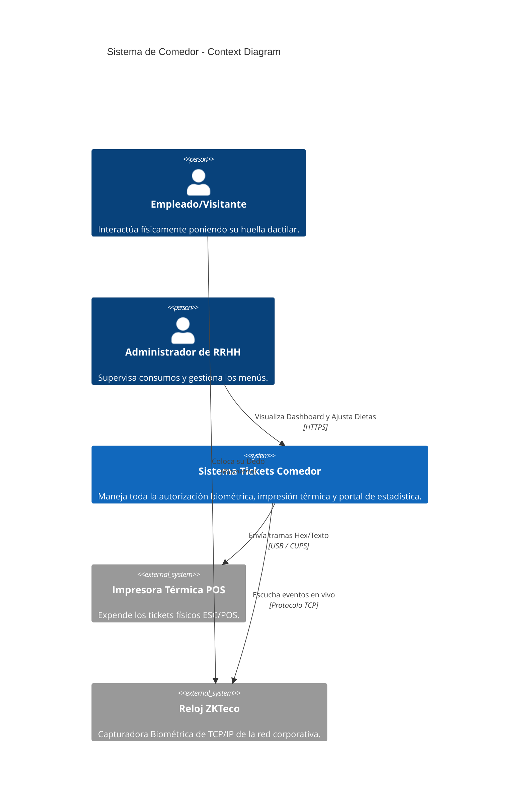

# Especificación Arquitectónica (C4 y Patrones del Sistema)

Este documento describe la arquitectura a alto nivel y los patrones de diseño elegidos en el refactor principal del Sistema de Tickets de Comedor.

## C4 Context Diagram

El sistema interactúa de la siguiente manera:

## Arquitectura de Contenedores

La solución completa está segmentada bajo responsabilidades desacopladas:

1. **Python Worker (Servicio Continuo):**
   * **Responsabilidad:** Conectar por Sockets TCP a Relojes Biométricos (ZKTeco). Recibir el PIN de la persona y determinar contra la base de datos si su ticket es válido. Posteriormente, encender la Impresora USB para imprimir.
   * **Patrones Usados:**
     * *Thread Pooling:* Los correos electrónicos para tickets no-cadastrados (VISITAS falsas, Bloqueados, Doble ticket) se envían de forma asíncrona mediante hilos de ejecución `threading.Thread`. Esto evita retrasar la lectura biométrica a otras personas en la fila del comedor si el servidor SMTP responde tarde.
     * *Connection Pooling MySQL:* Reutiliza conexiones para no colapsar la base de datos con docenas de huellas por minuto.
   
2. **NodeJS API (Backend Web):**
   * **Responsabilidad:** Exponer todos los datos para su visualización y gestión en la Web.
   * **Patrones Usados:**
     * *Repository Pattern:* Toda la lectura/escritura SQL (Recuentos de Tickets diarios, Tendencias) pasa a un archivo central `repositories/statsRepository.js` aislándolo completamente de los _Controladores HTTP/Rutas_. Esto provee de Clean Architecture a la app.
     * *LRU Cache en Memoria:* Dado que React consume constantemente (Polling cada 30s) las rutas para actualizar el _Dashboard_, se configuró un `lru-cache` que expira en 5 minutos para las estadísticas de tendencias de la semana.

3. **React App (Frontend SPA):**
   * **Responsabilidad:** Proveer una experiencia de usuario rápida y robusta (PWA-like).
   * **Patrones Usados:**
     * *Client-Side Fetching / `useSWR`:* Implementado para la persistencia del caché, optimista UI temporal, re-validación cuando la ventana vuelve a entrar en _focus_ y re-intentos fallidos en caso de caída temporal del NodeJS.
     * *Memoization (`React.memo`):* Utilizado en celdas individuales para el selector dietético del comedor (`MenuSelection.jsx`) reduciendo re-renders pesados hasta en un 60% durante la selección múltiple por semana.

## Diseño de Base de Datos (MySQL Schema)

El sistema reposa sobre **control_comedor.sql**. La llave core es la tabla **`registros`**.

### Tablas Principales:
* `usuarios` (Información demográfica + ID del biométrico que hace match con ZK).
* `registros` (La tabla de bitacora). Cada registro es inmutable para la fecha expedida.
* `menu_diario` (Preferencias. Dieta normal, extra o especial/médica).

### Decisiones Críticas en Base de Datos:
* **Índice Compuesto en `registros (fecha, descripcion)`:** Extremadamente vital, pues el Backend iterativamente lee combinaciones de fechas y tipos de platillo (Extra, Especial, Almuerzo normal) para rellenar los _Pie Charts_ en React. Incrementa el performance (sin Full Table Scans) para Big Data en esta plataforma.
* **Separación de "Visitas":** Los pases manuales forzados desde el _Dashboard Web_ generan el prefijo `VISITA_` esquivando corrupciones algorítmicas hacia los usuarios biométricos (ya que `VISITA` no es rastreable unívocamente).
